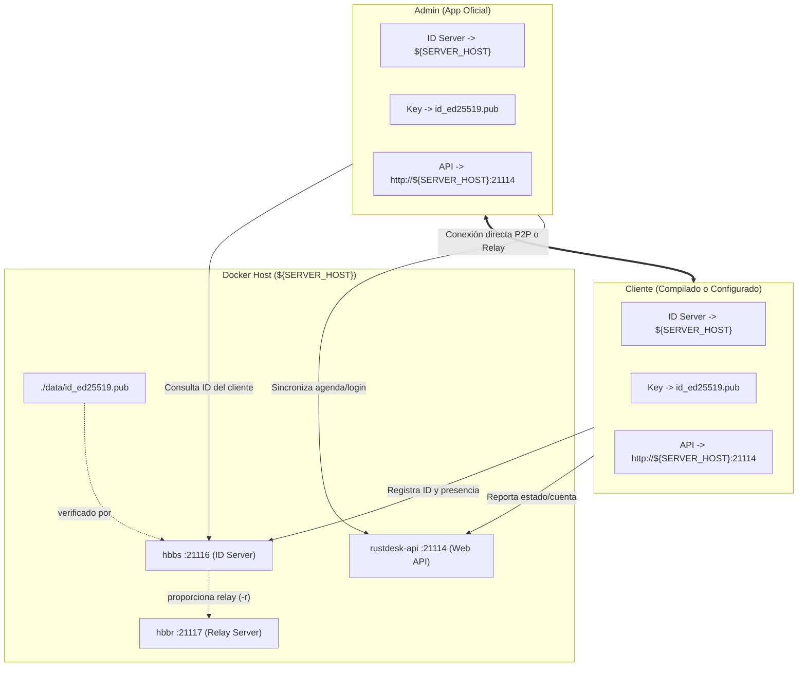

# Guía de Conexión del Cliente RustDesk a Servidor Local Propio

Esta guía detalla todo lo necesario para conectar este cliente de **RustDesk** a tu propia infraestructura desplegada mediante Docker Compose (`hbbs`, `hbbr` y `rustdesk-api`), y cómo conectar posteriormente la app oficial del administrador al cliente.

---

## 1. Mapa de Servicios y Parámetros del Servidor

A partir de tu archivo `docker-compose.yml`, los servicios exponen las siguientes funciones y puertos:

| Servicio | Contenedor | Puerto(s) | Función |
| :--- | :--- | :--- | :--- |
| **hbbs** | `hbbs` | **21116** (TCP/UDP)<br>21115 (TCP)<br>21118 (WS) | Servidor Rendezvous (Señalización, NAT traversal y registro de IDs). |
| **hbbr** | `hbbr` | **21117** (TCP)<br>21119 (WS) | Servidor Relay (Retransmisión de tráfico si la conexión directa falla). |
| **rustdesk-api** | `rustdesk-api` | **21114** (HTTP) | API Web (Autenticación de usuarios, libreta de direcciones, registro de dispositivos). |

### Los 4 Parámetros requeridos por el Cliente:
1. **ID Server (Rendezvous)**: `${SERVER_HOST}:21116` (o simplemente `${SERVER_HOST}`).
2. **Relay Server**: `${SERVER_HOST}:21117`.
3. **API Server**: `http://${SERVER_HOST}:21114`.
4. **Key (Clave Pública)**: Contenido del archivo de clave generado automáticamente por `hbbs` en `./data/id_ed25519.pub`.

> [!IMPORTANT]
> **Sobre `${SERVER_HOST}`:**
> Si el servidor corre en tu red local o en un servidor remoto, `${SERVER_HOST}` **no debe ser `localhost` ni `127.0.0.1`** (a menos que el cliente y el servidor estén estrictamente en la misma máquina física). Debe ser la **IP local de la máquina anfitriona** (ej. `192.168.1.100`) o un nombre de dominio / DDNS resoluble por los clientes.

### Cómo obtener la clave pública (`Key`)
Ejecuta en la máquina donde corre el Docker:
```bash
docker exec -it hbbs cat /root/id_ed25519.pub
```
o lee directamente el archivo montado en el host:
```bash
cat ./data/id_ed25519.pub
```
Obtendrás una cadena en base64 de 44 caracteres similar a: `EwDoQnySX2yGhyyd8DfWplYvGYjUexKrKVQMCP1Tbmk=`.

---

## 2. Opción A: Modificar el Código Fuente para Compilar un Cliente Preconfigurado

Si estás compilando el cliente desde este repositorio (`rustdesk`) y quieres que el binario resultante venga ya apuntando a tu servidor local de forma nativa (sin requerir configuración posterior por parte del usuario final), debes modificar los siguientes archivos:

### 2.1. Servidor ID predeterminado y Clave Pública
**Archivo:** [libs/hbb_common/src/config.rs](file:///c:/Users/JAN/Documents/GitHub/rustdesk/libs/hbb_common/src/config.rs#L116-L122)

Localiza las líneas 116 y 117:
```rust
// ANTES (Línea 116-117):
pub const RENDEZVOUS_SERVERS: &[&str] = &["localhost"];
pub const RS_PUB_KEY: &str = "EwDoQnySX2yGhyyd8DfWplYvGYjUexKrKVQMCP1Tbmk=";
```

Modifícalas por la dirección de tu servidor y la clave pública extraída de `./data/id_ed25519.pub`:
```rust
// DESPUÉS:
pub const RENDEZVOUS_SERVERS: &[&str] = &["192.168.1.100"]; // Cambia por tu IP o dominio
pub const RS_PUB_KEY: &str = "TU_CLAVE_PUBLICA_BASE64=";   // De id_ed25519.pub
```

> [!NOTE]
> `RENDEZVOUS_SERVERS` acepta opcionalmente el puerto (ej. `&["192.168.1.100:21116"]`), pero si no se especifica puerto, RustDesk usa automáticamente `RENDEZVOUS_PORT: i32 = 21116`.

### 2.2. Servidor API predeterminado
**Archivo:** [src/common.rs](file:///c:/Users/JAN/Documents/GitHub/rustdesk/src/common.rs#L1301-L1326)

En la función `get_api_server_`:
```rust
// ANTES (Línea 1325):
fn get_api_server_(api: String, custom: String) -> String {
    ...
    "https://admin.rustdesk.com".to_owned()
}
```

Cámbialo para que por defecto use tu contenedor `rustdesk-api`:
```rust
// DESPUÉS:
fn get_api_server_(api: String, custom: String) -> String {
    ...
    "http://192.168.1.100:21114".to_owned()
}
```

> [!TIP]
> **¿Por qué no es obligatorio hardcodear el Relay Server?**
> En tu `docker-compose.yml`, el comando de `hbbs` es:
> `command: hbbs -r ${SERVER_HOST}:21117`
> El flag `-r` indica a `hbbs` que cuando un cliente pregunte por un servidor de retransmisión (Relay), le entregue automáticamente la dirección `${SERVER_HOST}:21117`. Por tanto, el cliente recibe el Relay de forma dinámica desde el propio `hbbs`.

---

## 3. Opción B: Métodos Sin Recompilar (Tiempo de Ejecución)

Si no deseas recompilar el código para cada cambio o deseas usar instaladores precompilados, RustDesk ofrece varias formas estándar de inyectar la configuración:

### 3.1. Renombrar el ejecutable (Windows Portable / Instalador)
RustDesk incluye una funcionalidad nativa en [src/custom_server.rs](file:///c:/Users/JAN/Documents/GitHub/rustdesk/src/custom_server.rs#L64-L92) que parsea el nombre del archivo `.exe` al iniciarse y guarda automáticamente los valores en la configuración local:

Renombra el ejecutable a:
```text
rustdesk-host=192.168.1.100,key=TU_CLAVE_PUBLICA,api=http://192.168.1.100:21114,relay=192.168.1.100:21117.exe
```
Al hacer doble clic en este archivo, el cliente lee su propio nombre e importa la configuración sin intervención manual.

### 3.2. Archivo de Configuración Local (`RustDesk2.toml`)
Puedes crear o distribuir el archivo de configuración directamente en el equipo del cliente:

* **Windows**: `%APPDATA%\RustDesk\config\RustDesk2.toml` (o `C:\Windows\ServiceProfiles\LocalService\AppData\Roaming\RustDesk\config\RustDesk2.toml` si corre como servicio de sistema).
* **Linux**: `~/.config/rustdesk/RustDesk2.toml` (o `/etc/rustdesk/RustDesk2.toml` para el servicio root).
* **macOS**: `~/Library/Application Support/rustdesk/RustDesk2.toml`.

**Contenido de `RustDesk2.toml`:**
```toml
custom-rendezvous-server = '192.168.1.100'
relay-server = '192.168.1.100:21117'
api-server = 'http://192.168.1.100:21114'
key = 'TU_CLAVE_PUBLICA_BASE64='
```

### 3.3. Configuración por Línea de Comandos (`--config`)
Puedes aplicar la configuración mediante un script o comando por terminal:
```bash
rustdesk.exe --config "{\"host\":\"192.168.1.100\",\"relay\":\"192.168.1.100:21117\",\"api\":\"http://192.168.1.100:21114\",\"key\":\"TU_CLAVE_PUBLICA_BASE64=\"}"
```

### 3.4. Desde la Interfaz Gráfica (GUI)
1. Abre el cliente RustDesk.
2. Junto a tu ID, pulsa en el botón de menú (tres puntos verticales) o en el menú de la barra superior > **Red** / **Servidor ID/Relay**.
3. Pulsa **Desbloquear ajustes de red** (si requiere permisos de administrador).
4. Introduce:
   * **Servidor ID**: `192.168.1.100` (o `192.168.1.100:21116`)
   * **Servidor Relay**: `192.168.1.100:21117`
   * **Servidor API**: `http://192.168.1.100:21114`
   * **Clave (Key)**: Tu clave pública (`id_ed25519.pub`)
5. Haz clic en **Aceptar**.

---

## 4. Conexión del Administrador con la App Oficial de RustDesk

Para que el administrador se conecte al cliente utilizando la aplicación oficial de RustDesk (sin modificaciones de código):

1. **Instalar la app oficial**: Descargar la versión oficial de RustDesk para Windows, Linux, macOS o Android desde el repositorio oficial o web de RustDesk.
2. **Configurar el servidor en la app del Admin**:
   * Abrir RustDesk > **Ajustes** (icono de engranaje) > **Red** (o en los tres puntos del ID > **Servidor ID/Relay**).
   * Rellenar exactamente los mismos datos del servidor:
     * **Servidor ID**: `192.168.1.100`
     * **Servidor Relay**: `192.168.1.100:21117`
     * **Servidor API**: `http://192.168.1.100:21114`
     * **Key**: La misma clave pública de `./data/id_ed25519.pub`
3. **Inicio de sesión en la API (Opcional pero recomendado)**:
   * En la app del admin, ir a la sección de **Cuenta** / **Iniciar sesión**.
   * Introducir las credenciales del usuario admin creadas en el contenedor `rustdesk-api`.
   * Esto sincronizará automáticamente la libreta de direcciones (Address Book) y los dispositivos registrados.
4. **Establecer la conexión**:
   * En el cliente (el equipo remoto), verás el estado en verde: `Listo (Ready)`. Copia el **ID** y la **contraseña** (temporal o permanente).
   * En la app del admin, escribe el ID del cliente en el cuadro "Controlar escritorio remoto" y pulsa **Conectar**.
   * Introduce la contraseña cuando la solicite.
   * La conexión se establecerá directamente por NAT traversal (UDP 21116) o a través de `hbbr` (TCP 21117) de forma cifrada mediante la clave pública compartida.

---

## 5. Resumen de Flujo de Trabajo



Con estos ajustes, ambos extremos operarán de manera privada y segura dentro de tu propio servidor local.
